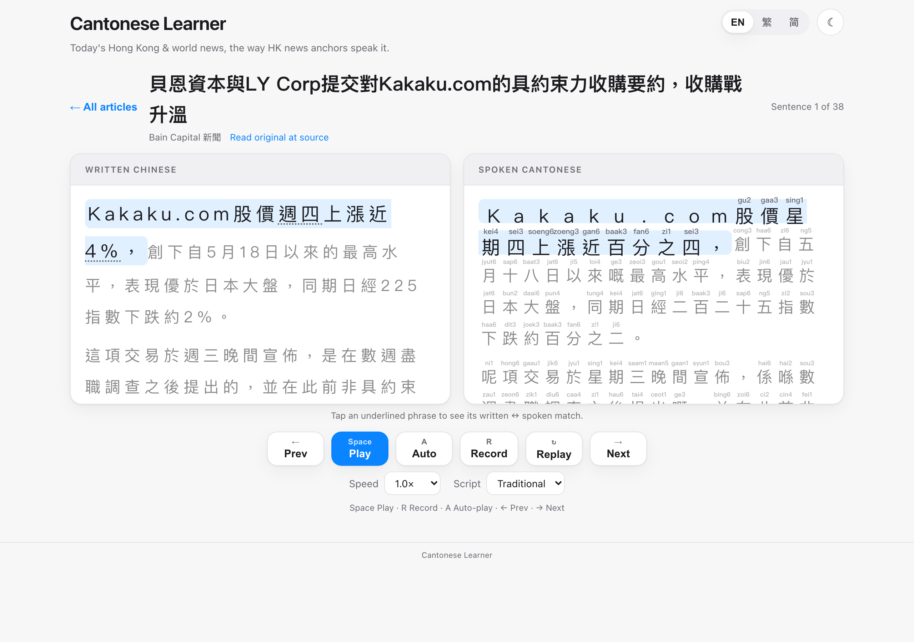

# Cantonese Learner V2

A static web app, rebuilt every morning, that turns the day's Hong Kong news into spoken-Cantonese reading practice: written Chinese beside an LLM rewrite in spoken Cantonese, jyutping over every character, neural audio, and per-character grading when you read aloud. It also has 96 everyday scenario dialogues.

[Live app](https://lyhjeremy.github.io/cantonese-learner-v2/) · [Write-up](https://lyhjeremy.github.io/cantonese-learner-v2/overview/) · [V1](https://lyhjeremy.github.io/cantonese-learner/)

Design and copy follow [these standards](https://github.com/lyhjeremy/lyhjeremy/blob/main/DESIGN_STANDARDS.md).



## At a glance

- About 12 news lessons a day from RTHK (five topics) plus a second source, rewritten by GPT-4.1 on GitHub Models and checked by a GPT-4.1-mini review pass, at no cost. An optional `ANTHROPIC_API_KEY` switches both passes to Claude.
- 96 scenario dialogues, 982 lines, in 8 categories of 12 (counted from `content/conversations-src.json`).
- Every sentence pre-rendered as neural zh-HK audio with edge-tts, one voice per speaker in dialogues.
- GitHub Actions builds the lessons at 06:00 Hong Kong time and publishes `frontend/` to GitHub Pages; there is no backend.
- 11 test files: `node:test` unit tests and a Playwright end-to-end test.

No sign-up, install or key. Use Chrome for the speaking and grading feature; other browsers can listen and read.

## How you use it

1. Open the app. The day's news is listed above the 8 conversation categories.
2. Open a lesson. Written Chinese sits on the left and spoken Cantonese on the right, with jyutping over every character. Phones get an interleaved view, each written line above its spoken version.
3. For each sentence: Play (`Space`), Auto-play the whole lesson (`A`), Record (`R`) to read it back. Each character is marked green, amber (a homophone) or red, with an overall score. `→` moves on.
4. Tap an underlined phrase to see its written and spoken counterparts highlighted together. Speed, Traditional or Simplified script, and an English, 繁體 or 简体 interface are all adjustable.

## How it works

```
GitHub Actions (daily cron, 06:00 HKT)                Browser (GitHub Pages, static)
┌──────────────────────────────────────────┐          ┌──────────────────────────────┐
│ 1. fetch RTHK RSS (5 topics)             │          │ loads today.json +           │
│    + Bain feed (bridge or web scrape)    │          │       conversations.json     │
│ 2. fetch full article bodies             │  writes  │ • side-by-side / interleaved │
│ 3. REWRITE → anchor Cantonese:           │  today   │   reader + jyutping ruby     │
│    Claude (if key) ▸ GitHub Models       │  .json   │ • tap-to-compare segments    │
│    (free, built-in token) ▸ rules        │  + MP3s  │ • NEURAL AUDIO per sentence  │
│ 4. REVIEW pass cross-checks rewrites     │ ───────► │   (edge-tts zh-HK voices;    │
│ 5. spell out numerals in context         │          │   browser TTS as fallback)   │
│ 6. add jyutping (to-jyutping, local)     │          │ • auto-play, speed control   │
│ 7. synthesise neural Cantonese audio     │          │ • SpeechRecognition grading  │
│    for EVERY sentence (edge-tts, free)   │          │ • trad⇄simp, tri-lingual UI  │
└──────────────────────────────────────────┘          └──────────────────────────────┘
```

- GitHub Actions is both the cron job and the build server, and the site is static files, so there is no backend server to keep running.
- Everything fails soft. No API key means the rule converter; a failed news fetch means bundled sample lessons; a clip that can't be synthesized falls back to the browser voice for that sentence; missing speech recognition hides the Record button.
- Grading runs in the browser through the Web Speech API (`yue-Hant-HK`). In Chrome, that API sends the recording to Google's speech service.

### The rewrite ladder (best available tier wins)

1. Claude rewrite and verifier (`ANTHROPIC_API_KEY` secret, Claude Opus 4.8): two structured-output calls per article, a rewrite that returns aligned phrase pairs and an independent reviewer that repairs anything unnatural. The day is labeled `llm+verify`.
2. GitHub Models (free, automatic): public-repo Actions can call GitHub's model inference with the workflow's own `GITHUB_TOKEN` (`permissions: models: read`). GPT-4.1 rewrites from a few-shot prompt that asks for restructured spoken Cantonese; if its daily quota runs out mid-build, remaining batches fall back to GPT-4.1-mini. A GPT-4.1-mini review pass then repairs mangled compounds and meaning drift and may not make a line less colloquial. Sentences the model leaves untouched get the rule converter as a floor. Calls are serialized with back-off and a per-model quota circuit breaker. Phrase pairs come from a local character-LCS aligner. `GH_MODELS_MODEL` overrides the rewriter.
3. Rule converter: the last resort, rebuilt after two reviewers audited its output. Single-character rules (不 to 唔, 這 to 呢, 那 to 嗰) gave way to phrase whitelists, quoted spans (「」《》) are never touched, sentence-final 了 becomes 喇, and a protect table covers transliterations, official-body names and 表示 collocations.

### Numbers

`frontend/numbers.js` is a dependency-free reading engine shared by the build and the browser. Output of `spellOutNumbers()`:

| Input | Reading | Rule |
|---|---|---|
| `2020年` | 二零二零年 | year, digit by digit |
| `2020個` | 二千零二十個 | quantity, cardinal |
| `15%` | 百分之十五 | percentage |
| `54.1` | 五十四點一 | decimal |
| `28463222` | 二八四六三二二二 | long digit run (phone number) |

The grader runs the recognizer's output through the same engine, so a correct reading scores green whether Chrome hears 二零二零年 or 2020年. Known gap: a space-separated number such as `2846 3222` is read as two cardinals.

### Natural audio

The browser's built-in Cantonese voice sounds robotic, so the daily build pre-synthesizes every sentence with Microsoft's free zh-HK neural voices through edge-tts (`scripts/build_audio.py`) and ships the MP3s as static files. News uses a female anchor voice; dialogues give each speaker a different voice. Speed control uses pitch-preserving `playbackRate`. Synthesis retries, writes atomically and fails soft.

### The conversations curriculum

`content/conversations-src.json` is the hand-authored source: written Chinese, spoken Cantonese and English, speaker by speaker, 8 categories × 12 scenarios, 96 dialogues and 982 lines. Each batch was checked by separate AI review passes, one for natural Cantonese and one for agreement between the three languages and Hong Kong accuracy (prices, Octopus, MTR, code-switching), before `npm run build:conversations` baked it to `frontend/data/conversations.json` with jyutping. That script enforces the 12-per-category floor, no digits, and no Cantonese-only characters in the written layer.

### The second news source

Up to 4 lesson slots go to a second source:

1. A WeChat 公眾號 RSS bridge, if `WECHAT_FEED_URL` is set (WeChat has no public API, so a bridge such as WeRSS or Wechat2RSS is the only route).
2. Otherwise, with no setup, a scrape of Google News (zh-HK) for 貝恩資本 (Bain Capital) coverage, resolved to the publisher's page and converted like RTHK news. `BAIN_NEWS_QUERY` changes the query; `off` disables it.

`backend/junk.js` filters stale-page banners, disclaimers, cookie and paywall prompts and copyright footers; an article left with nothing but boilerplate is dropped. If either source fails, the build continues with RTHK only. Anything the build ingests is published on the public site, so only connect feeds that are fine to republish.

## Limitations

- Grading needs Chrome, and Chrome's speech recognition runs on Google's servers.
- The spoken Cantonese in news lessons is machine-written and machine-reviewed. The review pass cuts errors but does not remove them.
- News lessons are rebuilt daily and not archived.
- Space-separated digit groups are read as cardinals (see Numbers).

## Run it locally

```bash
npm install          # deps for the builders + tests
npm run serve        # serves the app at http://localhost:5173
npm run build:news   # fetch + convert today's lessons (keyless without a key)
npm run build:conversations   # regenerate conversations.json from the source
```

To exercise the Claude rewrite locally:

```bash
ANTHROPIC_API_KEY=sk-ant-… npm run build:news
```

## Deploy

Push to `main`. `.github/workflows/pages.yml` builds the day's lessons and
publishes `frontend/` to GitHub Pages, then re-runs daily at 06:00 HKT.
`keepalive.yml` makes a tiny commit twice a month so GitHub never auto-disables
the schedule.

Secrets and variables (repo → Settings → Secrets and variables → Actions):

| Name | Type | Required? | Purpose |
|---|---|---|---|
| *(nothing)* | n/a | n/a | The free tier (GitHub Models rewrite and neural audio) needs no setup |
| `ANTHROPIC_API_KEY` | secret | optional | Upgrade the rewrite to Claude + independent verifier |
| `GH_MODELS_MODEL` | variable | optional | Change the free rewrite model (default `openai/gpt-4.1`; falls back to `openai/gpt-4.1-mini`) |
| `WECHAT_FEED_URL` | secret | optional | RSS-bridge URL for the WeChat 公眾號 feed (overrides the web-scrape fallback) |
| `WECHAT_SOURCE_NAME` | variable | optional | Source label for the secondary-feed lessons |
| `BAIN_NEWS_QUERY` | variable | optional | Web-scrape fallback topic (default 貝恩資本; `off` disables) |

## Tests

```bash
npm test             # unit (chunking, rules, rewrite+verify mocked, grader,
                     #       rss + wechat fixture, numbers) + Playwright e2e
npm run test:unit
npm run test:e2e     # renders the app headless: segments, tap-to-compare,
                     #       auto-play, conversations, interleaved mobile view
npm run validate:data
```

## Repository layout

```
frontend/            the static site (GitHub Pages)
  index.html         reader UI (panes + interleaved + transport)
  app.js             reader, segments, auto-play, conversations, tri-lingual UI
  grader.js          speech recognition + lenient grading (script/register/
                     homophone/number leniency)
  numbers.js         context-aware numeral → Cantonese-reading engine (shared)
  tts.js             zh-HK text-to-speech with voice re-resolution
  i18n.js            English / Traditional / Simplified labels
  data/              sample-lessons.json, jyutping.json, conversations.json
                     (8 categories × 12 scenarios), today.json (generated daily)
  audio/             per-sentence neural MP3s (generated per deploy, not committed)
backend/             shared logic used by the daily build
  chunk.js           CJK sentence chunking + packing
  rss.js             RTHK RSS + full-body extraction + custom-feed (WeChat) seam
  gnews.js           web-scrape fallback: Google News query → publisher URL
                     decode → generic article-body extraction
  junk.js            boilerplate filter: stale-page banners, disclaimers,
                     paywall prompts never become lessons
  convert.js         Claude rewrite + verifier (Anthropic SDK, structured outputs)
  ghmodels.js        FREE rewrite tier: GitHub Models + review pass + quota breaker
  align.js           character-LCS written↔spoken pair aligner
  convert-rules.js   audited keyless written→spoken converter + segment pairs
content/
  conversations-src.json   hand-authored conversations curriculum (source)
scripts/             build-lessons, build-conversations, build_audio.py
                     (edge-tts neural synthesis), build-jyutping-dict,
                     dev server, data validator
tests/               node:test unit tests + Playwright e2e
.github/workflows/   pages.yml (daily build + deploy), keepalive.yml
```

## Credits

Built on the V1 [cantonese-learner](https://github.com/lyhjeremy/cantonese-learner).
News content © RTHK, lessons link back to the original articles. Jyutping via
[to-jyutping](https://www.npmjs.com/package/to-jyutping); Traditional⇄Simplified
via OpenCC. Rewrites by GPT-4.1 on GitHub Models, or Claude when a key is set.

## License

[MIT](LICENSE) © 2026 Jeremy Lee
